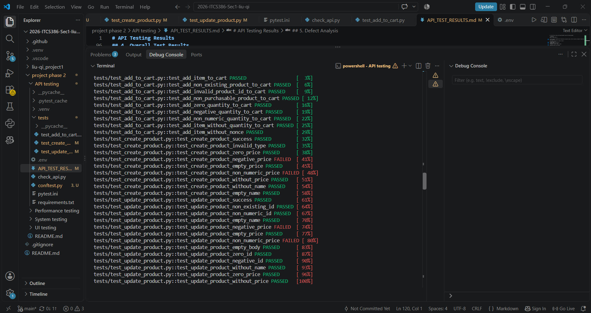

# API Testing Results

## 1. Overview

This document summarizes the results of API testing for Project 2. The tests were implemented using **Python, pytest, and requests** to verify the functionality and error handling of the WooCommerce REST API and Store API.

The API testing covers three main operations:

1. **Create Product** – Testing product creation with valid and invalid input values.
2. **Update Product** – Testing product updates using different product IDs and input conditions.
3. **Add to Cart** – Testing adding products to the shopping cart with valid and invalid product IDs, quantities, and request headers.

## 2. Test Environment

| Item | Configuration |
|---|---|
| Operating System | Windows |
| Programming Language | Python 3.12.2 |
| Testing Framework | pytest 9.2.0 |
| HTTP Library | requests |
| API | WooCommerce REST API / Store API |
| Test Execution | `python -m pytest tests -v` |

## 3. Test Suites

### 3.1 Create Product

**Test File:** `tests/test_create_product.py`

**Objective:** Verify that the API can create products and handle different input conditions.

| Test Case | Description | Expected Result | Actual Result | Status |
|---|---|---|---|---|
| CP01 | Create product with valid data | HTTP 201, product is created | Product created successfully | PASS |
| CP02 | Create product with invalid product type | HTTP 400, error response | Error response returned | PASS |
| CP03 | Create product with zero price | HTTP 201, product has zero price | Product created with zero price | PASS |
| CP04 | Create product with negative price | HTTP 400, error response | HTTP 201, negative price accepted | FAIL |
| CP05 | Create product with empty price | HTTP 201, product has empty price | Product created with empty price | PASS |
| CP06 | Create product with non-numeric price | HTTP 400, error response | HTTP 201, invalid price silently discarded | FAIL |
| CP07 | Create product without price | HTTP 201, product has empty price | Product created with empty price | PASS |
| CP08 | Create product without name | HTTP 201, default product name | Product created with default name | PASS |
| CP09 | Create product with empty name | HTTP 201, default product name | Product created with default name | PASS |

**Result:** 7 passed, 2 failed.

CP04 and CP06 revealed defects in product price validation. The API accepted a negative price and silently discarded a non-numeric price instead of returning the expected error response.

### 3.2 Update Product

**Test File:** `tests/test_update_product.py`

**Objective:** Verify that the API can update existing products and handle invalid product IDs and different input conditions.

| Test Case | Description | Expected Result | Actual Result | Status |
|---|---|---|---|---|
| UP01 | Update product with valid data | HTTP 200, product is updated | Product updated successfully | PASS |
| UP02 | Update product with non-existing ID | Invalid product ID error | Expected error response returned | PASS |
| UP03 | Update product with non-numeric ID | Route error | Expected route error returned | PASS |
| UP04 | Update product with empty name | Original name is retained | Original name retained | PASS |
| UP05 | Update product with negative price | HTTP 400, error response | HTTP 200, negative price accepted | FAIL |
| UP06 | Update product with empty price | HTTP 200, empty price is accepted | Empty price returned | PASS |
| UP07 | Update product with non-numeric price | HTTP 400, error response | HTTP 200, original price cleared | FAIL |
| UP08 | Update product with empty request body | Original product data is retained | Original product data retained | PASS |
| UP09 | Update product with zero ID | Invalid product ID error | Expected error response returned | PASS |
| UP10 | Update product with negative ID | Route error | Expected route error returned | PASS |
| UP11 | Update product without name | Original name is retained | Original name retained | PASS |
| UP12 | Update product with zero price | HTTP 200, product has zero price | Product updated with zero price | PASS |
| UP13 | Update product without price | Original price is retained | Original price retained | PASS |

**Result:** 11 passed, 2 failed.

UP05 and UP07 revealed defects in product price validation. The API accepted a negative price and accepted a non-numeric price, which caused the original product price to be cleared.

### 3.3 Add to Cart

**Test File:** `tests/test_add_to_cart.py`

**Objective:** Verify that the Store API can add products to the shopping cart and handle invalid product IDs, quantities, and missing request headers.

| Test Case | Description | Expected Result | Actual Result | Status |
|---|---|---|---|---|
| AC01 | Add a valid product to cart | Product is added successfully | Product added successfully | PASS |
| AC02 | Add a non-existing product to cart | HTTP 400, invalid product error | Invalid product error returned | PASS |
| AC03 | Add a product using a non-numeric ID | HTTP 400, invalid product error | Invalid product error returned | PASS |
| AC04 | Add a non-purchasable product to cart | HTTP 400, product not purchasable error | Product not purchasable error returned | PASS |
| AC05 | Add a product with zero quantity | HTTP 400, invalid quantity error | Invalid quantity error returned | PASS |
| AC06 | Add a product with negative quantity | HTTP 400, invalid quantity error | Invalid quantity error returned | PASS |
| AC07 | Add a product with non-numeric quantity | HTTP 400, invalid parameter error | Invalid parameter error returned | PASS |
| AC08 | Add a product without specifying quantity | Product is added with default quantity | Product added with default quantity of 1 | PASS |
| AC09 | Add a product without the Nonce header | HTTP 401, missing Nonce error | Missing Nonce error returned | PASS |

**Result:** 9 passed, 0 failed.

All Add to Cart test cases passed. The API returned the expected responses for valid requests, invalid product IDs, invalid quantities, and a missing Nonce header.

## 4. Overall Test Results

All three API test suites were executed together using the following command:

```powershell
python -m pytest tests -v
```

The test execution completed with 27 passed and 4 failed test cases. The four failures correspond to identified API defects related to product price validation.

| Test Suite | Total Tests | Passed | Failed |
|---|---:|---:|---:|
| Create Product | 9 | 7 | 2 |
| Update Product | 13 | 11 | 2 |
| Add to Cart | 9 | 9 | 0 |
| **Total** | **31** | **27** | **4** |

**Execution Time:** 11.69 seconds

**Overall Result:** 27 passed, 4 failed.



The four failed test cases revealed API behaviors that did not meet the price validation requirements defined by the project team.

## 5. Defect Analysis

Four defects were identified during API testing.

### DEF-API-01: API Accepts Negative Product Price During Creation

- **Related Test Case:** CP04
- **Operation:** `POST /wc/v3/products`
- **Request Body:**

```json
{
  "name": "G01 Test Product CP04",
  "type": "simple",
  "regular_price": "-100"
}
```

- **Expected Result:** HTTP 400 Bad Request with an error message because the product price must not be negative.
- **Actual Result:** HTTP 201 Created. The API accepted `-100` as the product price and returned `purchasable: true`. However, `price_html` displayed `฿0.00`.

### DEF-API-02: API Accepts Non-Numeric Product Price During Creation

- **Related Test Case:** CP06
- **Operation:** `POST /wc/v3/products`
- **Request Body:**

```json
{
  "name": "G01 Test Product CP06",
  "type": "simple",
  "regular_price": "abc"
}
```

- **Expected Result:** HTTP 400 Bad Request with an error message because the product price must be numeric.
- **Actual Result:** HTTP 201 Created. The API silently converted the price to an empty value. The response returned an empty `regular_price` and `price`, with `purchasable: false`.

### DEF-API-03: API Accepts Negative Product Price During Update

- **Related Test Case:** UP05
- **Operation:** `PUT /wc/v3/products/{id}`
- **Request Body:**

```json
{
  "regular_price": "-100"
}
```

- **Expected Result:** HTTP 400 Bad Request with an error message because the product price must not be negative.
- **Actual Result:** HTTP 200 OK. The API updated the product price to `-100` and returned `purchasable: true`. However, `price_html` displayed `฿0.00`.

### DEF-API-04: API Clears Existing Product Price When Updating With Non-Numeric Value

- **Related Test Case:** UP07
- **Operation:** `PUT /wc/v3/products/{id}`
- **Request Body:**

```json
{
  "regular_price": "abc"
}
```

- **Expected Result:** HTTP 400 Bad Request with an error message. The original product price should remain unchanged.
- **Actual Result:** HTTP 200 OK. The API silently cleared the original product price, resulting in an empty `regular_price` and `price`, with `purchasable: false`.

## 6. Conclusion

The API testing covered three major operations: Create Product, Update Product, and Add to Cart.

A total of **31 test cases** were executed, with **27 passed and 4 failed**. The tests covered valid inputs, invalid inputs, boundary values, omitted fields, and missing request headers.

The Add to Cart suite passed all 9 test cases. However, the Create Product and Update Product suites revealed four defects related to product price validation.

The most significant issue is DEF-API-04, where updating a product with a non-numeric price silently removes its existing price. This may lead to unintended changes to product data.

The four failed tests represent identified system defects based on the validation requirements defined by the project team, rather than test implementation errors.

These findings demonstrate the importance of input validation and data integrity in API operations.

