# Evidence index

All E01–E13 images are genuine browser captures from **18 November 2026**. They are retrospective supplements. H01–H03 are unchanged copies of historical source images, not new executions.

Sensitive contact/address/IP areas were excluded from new captures. No screenshot values were painted over, generated or reconstructed. Source URLs below identify cropped records. Times in order notes are site-displayed; the site timezone was not established.

Browser timestamps for E04 onward are in `capture-log.json` (UTC). E01–E03 were saved before per-capture logging began; their file save times in `FILE_MANIFEST.json` are provenance metadata, not independent proof of capture time. Historical file timestamps are not asserted as original execution times.

## E01 — Order #127 history

Recorded Processing → Completed; stock 10 → 8; mail failures. Site-displayed November 11 timestamps; source URL supplies order identity.

[Source page](http://157.85.102.236/shop/wp-admin/admin.php?page=wc-orders&action=edit&id=127)

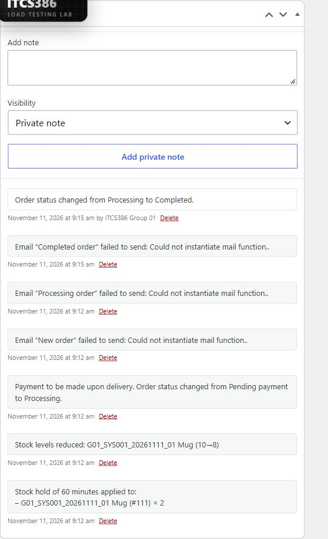

## E02 — Order #127 line items and total

Mug THB 199 ×2 = THB 398; COD. Header/contact region excluded. Paid label is not proof of physical cash collection.

[Source page](http://157.85.102.236/shop/wp-admin/admin.php?page=wc-orders&action=edit&id=127)

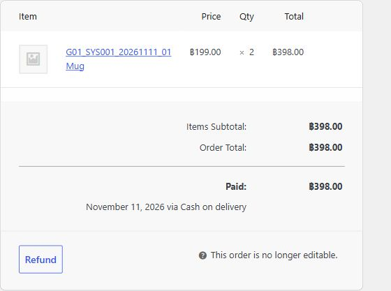

## E03 — Order #127 general fields

Completed, creation date November 11, guest. Order heading is outside this crop; use with E13 and source URL.

[Source page](http://157.85.102.236/shop/wp-admin/admin.php?page=wc-orders&action=edit&id=127)

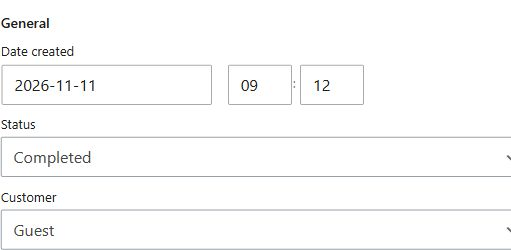

## E04 — Order #139 original coupon and discount

Stored coupon gv82wtw5; subtotal 400, discount 40, total 360; quantity 2. The coupon link led to ID 138.

[Source page](http://157.85.102.236/shop/wp-admin/admin.php?page=wc-orders&action=edit&id=139)

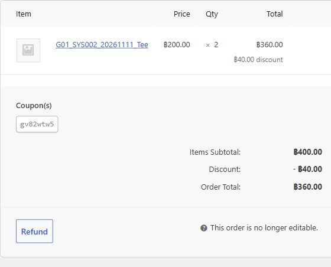

## E05 — Coupon ID 138 current code

Current edit field G01-GV82WTW5. Does not prove original naming compliance or rename time.

[Source page](http://157.85.102.236/shop/wp-admin/post.php?post=138&action=edit)

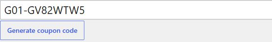

## E06 — Coupon ID 138 percentage settings

Percentage discount, amount 10. Narrow capture clips unrelated help text; values used in this report are visible.

[Source page](http://157.85.102.236/shop/wp-admin/post.php?post=138&action=edit)

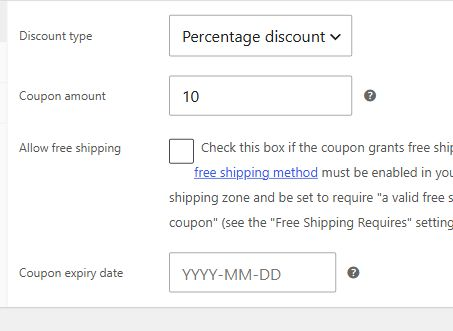

## E07 — Coupon current usage

Expanded row shows g01-gv82wtw5, Percentage discount, 10 and Usage / Limit 2 / infinity. No order-specific usage delta established.

[Source page](http://157.85.102.236/shop/wp-admin/edit.php?post_type=shop_coupon&s=G01-GV82WTW5)

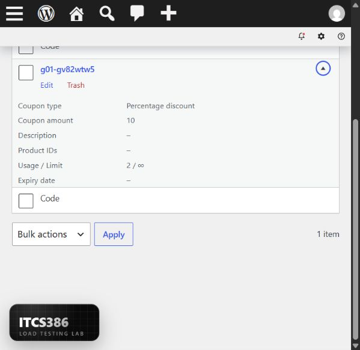

## E08 — Order #142 recorded stock reduction

Notes explicitly record product #141 ×2 and stock 3 → 1 on November 11 at 10:23 (site-displayed time). Mail failures also visible.

[Source page](http://157.85.102.236/shop/wp-admin/admin.php?page=wc-orders&action=edit&id=142)

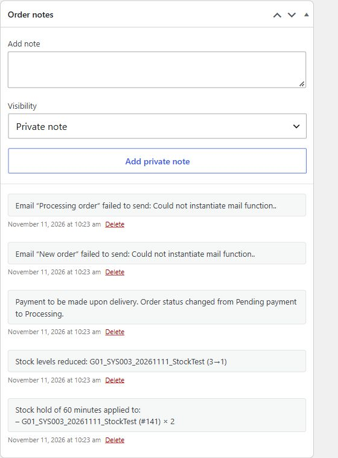

## E09 — Order #142 product and total

StockTest THB 150 ×2 = THB 300. Order heading excluded; source URL records identity.

[Source page](http://157.85.102.236/shop/wp-admin/admin.php?page=wc-orders&action=edit&id=142)

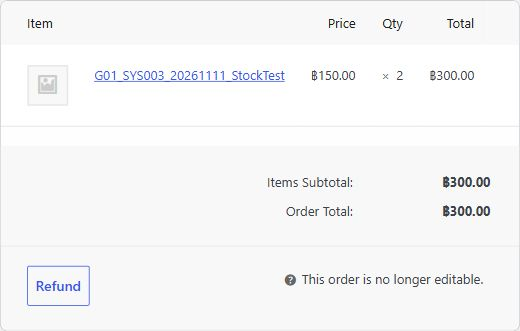

## E10 — Product #141 inventory

Track stock checked, quantity 1, backorders Do not allow. Site badge partly covers left-side labels; use the visible values with E08, E11 and E12.

[Source page](http://157.85.102.236/shop/wp-admin/post.php?post=141&action=edit)

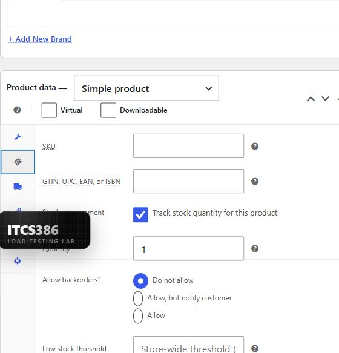

## E11 — Product #141 identity

G01_SYS003_20261111_StockTest and permalink; companion to inventory crop.

[Source page](http://157.85.102.236/shop/wp-admin/post.php?post=141&action=edit)

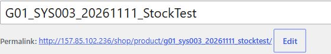

## E12 — Storefront remaining stock

Same product, THB 150, 1 in stock. Logged-in Group 01 session, not an independent guest test.

[Source page](http://157.85.102.236/shop/product/g01_sys003_20261111_stocktest/)

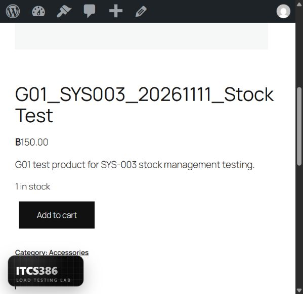

## E13 — Order #127 final list verification

Filtered, expanded row: #127, Nov 11, Completed, THB 398. Captured November 18; supplemental to the fully obscured original list screenshot.

[Source page](http://157.85.102.236/shop/wp-admin/admin.php?page=wc-orders&s=127)

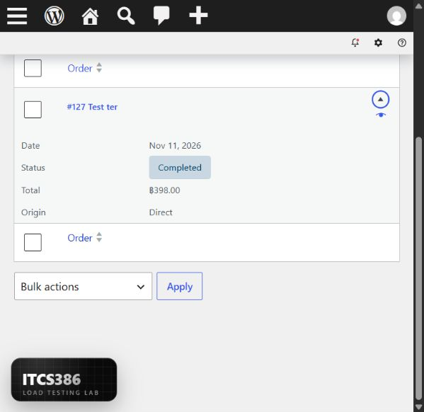

## Historical comparisons

### H01_SYS001_original_empty_cart.png

Original Step 10 image shows an empty cart; it does not establish the Checkout → Back sequence.

Original source: `System testing/screenshots/SYS-001/Sys001-10.png`

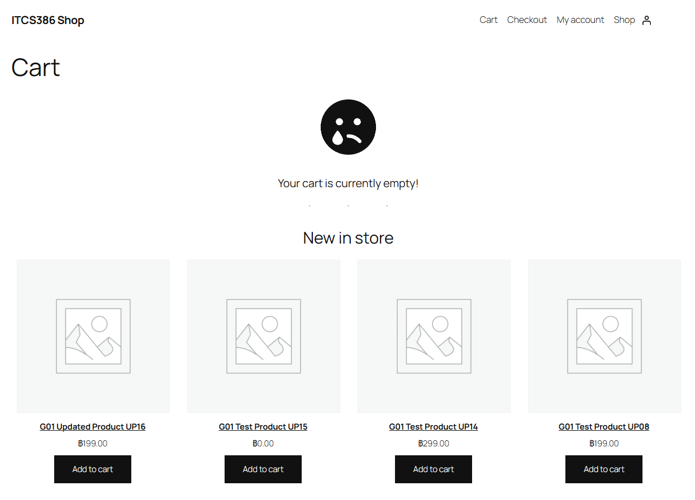

### H02_SYS001_original_obscured_orders.png

Original final-list image obscures all order rows.

Original source: `System testing/screenshots/SYS-001/Sys001-15.png`

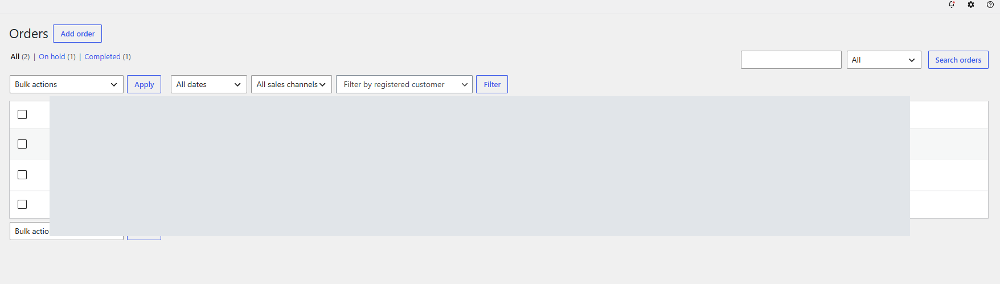

### H03_SYS002_original_checkout.png

Original checkout screenshot shows coupon gv82wtw5, correcting workbook F16 transcription. Existing redaction preserved.

Original source: `System testing/screenshots/SYS-002/Sys002-8.png`

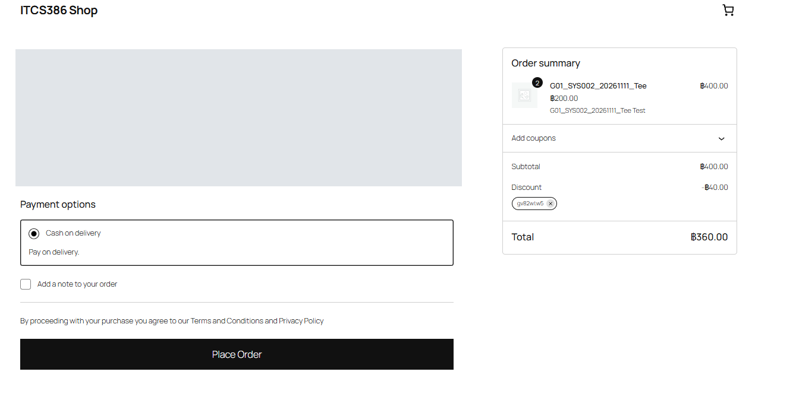
